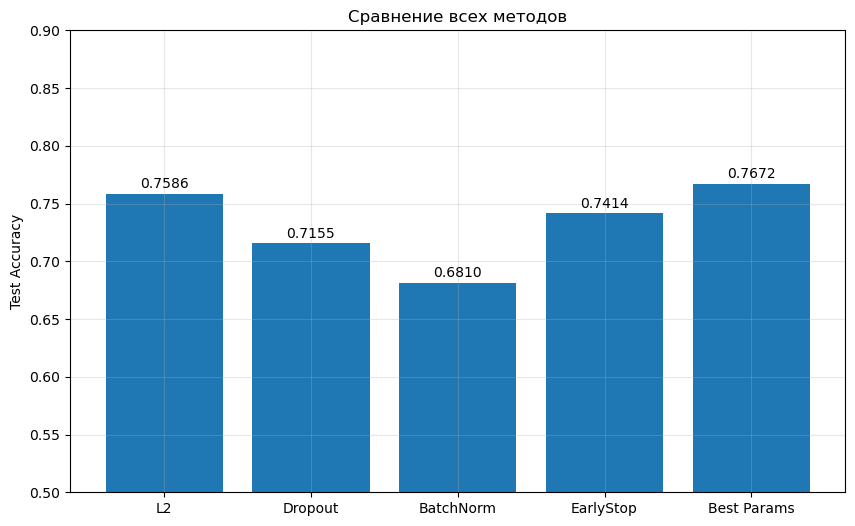
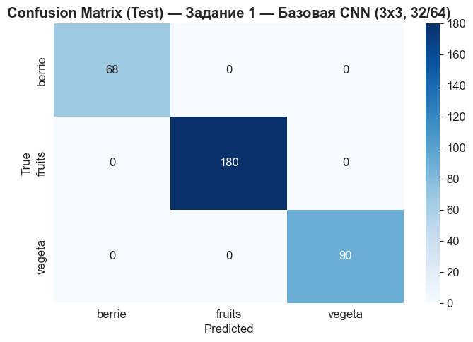
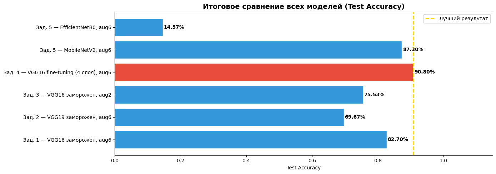
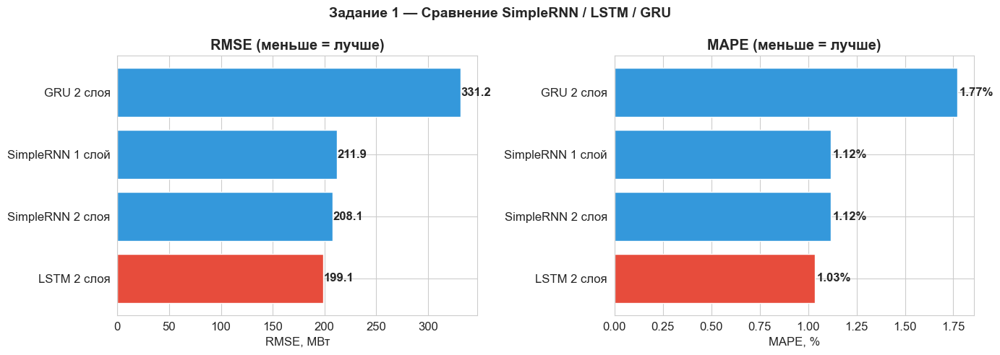
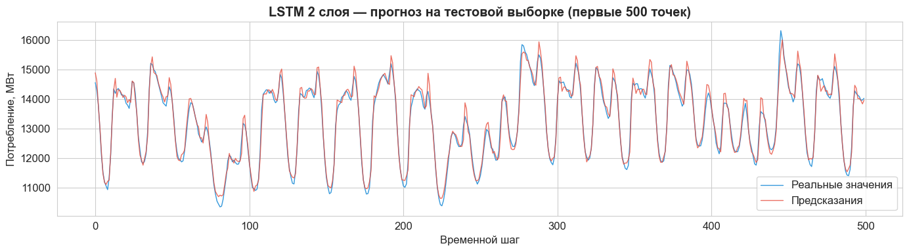

# Neural Networks and Deep Learning Labs

Lab work from the **Neural Networks and Deep Learning** course (3rd year, semester 6) at Don State Technical University (DSTU), built with **TensorFlow / Keras**.
Every lab runs a series of controlled experiments, logs them to JSON and compares the results in a summary table and plots.

| Lab | Topic | Data | Best result |
|---|---|---|---|
| [1–2](lab1-2-dense-networks) | Dense networks, regularisation, hyperparameter tuning | Pima Indians Diabetes | **77.6%** test accuracy (simple architecture); tuned model 76.7% |
| [3](lab3-cnn) | CNNs and ways to improve training | Fruits / berries / vegetables (3 classes) | **100%** on the held-out test split for all 6 configurations |
| [4](lab4-transfer-learning) | Data augmentation and transfer learning | Fruits dataset; Intel Image Classification (6 classes) | VGG16 fine-tuning: **64.7%** on fruits, **90.8%** on Intel images |
| [5](lab5-rnn) | Recurrent networks for time-series forecasting | Hourly energy consumption (AEP, PJM) | 2-layer **LSTM: RMSE 199 MW, MAPE 1.03%** |

## Lab 1–2: dense networks

A fully connected classifier for diabetes diagnosis: comparison of simple, deep and wide architectures, then L2, Dropout, BatchNorm, early stopping, k-fold cross-validation and a hyperparameter search (units, dropout rate, learning rate).



## Lab 3: convolutional networks

A baseline CNN (3×3 kernels, 32/64 filters), then the effect of the kernel size (3×3, 5×5, 7×7, 5×5→3×3), the number of filters (8/16 … 64/128), strided convolutions, VGG-style double blocks, BatchNorm and Dropout. The notebook explicitly checks that the train, validation and test splits do not overlap. Every configuration reached 100% test accuracy, so this dataset is easy for a CNN, and the differences show up only in convergence speed and the train/validation gap.



## Lab 4: augmentation and transfer learning

Six experiments on two datasets: a frozen VGG16 with 6 augmentations, VGG19 instead of VGG16, 2 vs 6 augmentations, VGG16 with the last 4 layers fine-tuned, MobileNetV2 and EfficientNetB0.

| Model | Fruits | Intel images |
|---|---|---|
| **VGG16, fine-tuning (4 layers)** | **64.7%** | **90.8%** |
| MobileNetV2 | 58.5% | 87.3% |
| VGG16 frozen, 6 augmentations | 58.2% | 82.7% |
| VGG16 frozen, 2 augmentations | 36.9% | 75.5% |
| VGG19 frozen | 41.3% | 69.7% |
| EfficientNetB0 | 53.2% | 14.6% |

- Fine-tuning the top layers beats a frozen backbone on both datasets.
- More augmentation helps a frozen backbone a lot (+21 pp on fruits, +7 pp on Intel images).
- EfficientNetB0 collapsed on Intel images and predicted a single class for every image. The likely cause is preprocessing: the pipeline rescales pixels to 0–1, while Keras' EfficientNet expects raw 0–255 values and normalises them internally.



## Lab 5: recurrent networks

Hourly electricity consumption, 7 days of history as input. Point forecast of the next hour with SimpleRNN, LSTM and GRU, plus an interval forecast of the next 24 hours.

| Model | RMSE, MW | MAE, MW | MAPE |
|---|---|---|---|
| **LSTM, 2 layers** | **199.1** | **149.4** | **1.03%** |
| SimpleRNN, 2 layers | 208.1 | 158.4 | 1.12% |
| SimpleRNN, 1 layer | 211.9 | 160.8 | 1.12% |
| GRU, 2 layers | 331.2 | 260.6 | 1.77% |
| LSTM, 24-hour interval forecast | 1199.2 | 955.3 | 6.74% |





## Data and models

| Data | Where |
|---|---|
| Pima Indians Diabetes | `lab1-2-dense-networks/diabetes.csv` |
| Fruits / berries / vegetables (22,495 images) | `frukta.zip` in the [GitHub release](../../releases); unpack it next to the lab 3 / lab 4 notebooks |
| Intel Image Classification | downloaded in the notebook with `kagglehub` (`puneet6060/intel-image-classification`) |
| Hourly Energy Consumption | downloaded in the notebook with `kagglehub` (`robikscube/hourly-energy-consumption`) |

Trained models: `best_model.h5` (labs 1–2) is in the repository; `best_model.keras` (lab 3) and `best_model_lab4.keras` (lab 4) are in the release.

Each lab folder has a `drafts/` subfolder with earlier versions of the notebook.

## How to run

```bash
pip install tensorflow scikit-learn pandas numpy matplotlib seaborn kagglehub jupyter
jupyter notebook
```

## Tech stack

Python · TensorFlow / Keras · scikit-learn · pandas · NumPy · Matplotlib · seaborn

## License

[MIT](LICENSE)
